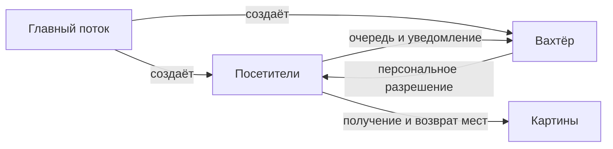

# Отчёт по индивидуальному заданию № 2

**Дисциплина:** «Архитектура компьютера и операционные системы».

**Тема:** многопоточная имитация рабочего дня картинной галереи.

**Исполнитель:** Нестеров Дан Александрович, группа БПИ253. **Вариант:** 16.

## 1. Условие и выбранная модель

Галерея имеет ограничение общего числа посетителей и зрителей у каждой картины. Посетители прибывают через случайные интервалы, ждут допуска вахтёра, осматривают все картины и выходят. Программа отображает все девять предметных событий, включая ожидание входа и места у картины. Требуется консольная многопоточная имитация рабочего дня галереи.

Реализована конечная модель на C11 для Linux с pthread: `gallery` использует мьютекс и семафоры, `gallery-cond` — мьютексы и условные переменные. На входе выбран FIFO по порядку регистрации. Посетитель ожидает выбранную картину; порядок осмотра — случайная перестановка (`random`) или последовательность по номерам (`sequential`). Эти политики являются решениями проекта.

## 2. Потоки и устройство программы

| Участник | Работа |
| --- | --- |
| Главный поток | Создаёт участников через случайные интервалы, закрывает генерацию и присоединяет потоки. |
| Вахтёр (`warden_main`) | Обслуживает очередь и единолично выдаёт персональные разрешения входа. |
| Каждый посетитель (`visitor_main`) | Регистрируется, ждёт допуска, проходит маршрут и освобождает место. |
| Сигнальный поток (`signal_main`) | Принимает сигналы через `sigwait` и запрашивает остановку. |
| Картины | Общие ресурсы с разрешениями и счётчиками; активного поведения и отдельных потоков нет. |

При N созданных посетителях существует не более N + 3 одновременно работающих потоков. Ресурсы завершившихся посетителей освобождаются после окончания генерации и присоединения потоков.



`simulation.c` управляет ресурсами и потоками, `gallery.c` содержит поведение участников, `events.c` — вывод. Закрытые структуры находятся в `src/simulation_internal.h`, открытые интерфейсы — в `include/`. `Gallery` объединяет конфигурацию, синхронизацию, память, очередь, статистику, жизненный цикл и вывод. Счётчики подготовленных ресурсов позволяют очищать частично инициализированную модель.

## 3. Синхронизация и инварианты

Один мьютекс модели защищает очередь, состояния, счётчики, флаги и порядок событий. Семафоры используются для уведомлений вахтёра, личного допуска посетителей и мест у каждой картины. Во второй программе тот же интерфейс `Permit` реализован счётчиком, мьютексом и условной переменной; ожидание проверяет условие в цикле. Семафорных вызовов в `gallery-cond` нет.

| Инвариант | Обеспечение |
| --- | --- |
| Вместимость галереи не превышается | Вахтёр проверяет и увеличивает занятость при выдаче разрешения, до пробуждения посетителя. |
| Лимит картины соблюдается | Место получается до начала осмотра и возвращается после его окончания. |
| Одновременно осматривается не более одной картины | Предыдущее место освобождается до ожидания следующего. |
| Картина не засчитывается повторно | Маршрут содержит все номера ровно один раз. |
| Выход освобождает место галереи | Единственный переход завершения уменьшает занятость. |

Счётчик ожидаемых регистраций увеличивается до `pthread_create`, уменьшается при прибытии и откатывается при ошибке создания. Поэтому вахтёр не завершится раньше поздно запущенного посетителя. Ожидание разрешений, задержки и `pthread_join` не удерживают мьютекс модели; обратного порядка захвата мьютексов нет. Посетитель не удерживает картину при ожидании другой, поэтому цикла взаимного ожидания ресурсов не возникает. Прогресс требует планирования готовых потоков и завершения обычного файлового ввода-вывода; FIFO у картин не гарантируется.

## 4. Интерфейс, запуск и завершение

Параметры читаются через `getopt_long` и inih r62 с приоритетом «по умолчанию → файл → командная строка». Числа и диапазоны проверяются до запуска потоков. Задержки равномерно выбираются в целых миллисекундах; отдельные генераторы SplitMix64 воспроизводят назначенные маршруты и задержки по `seed`, но не расписание потоков. Формат вывода — JSON Lines с русскими пояснениями, монотонным временем и последовательными номерами событий. Ввод и вывод используют файловые дескрипторы.

Сборка, полный перечень параметров, синтаксис файла и коды завершения описаны в [README.md](README.md). Примеры из `hw2/` после сборки в Linux:

```sh
./build/gallery --config tests/cases/demo.conf --log demo.log
./build/gallery --config tests/cases/demo.conf --visitors 300 --log large.log
./build/gallery-cond --config tests/cases/contention.conf
./build/gallery --visitors 0
```

Штатно генерация закрывается после последнего создания. Вахтёр ждёт опустошения очереди, регистрации всех созданных потоков и выхода допущенных посетителей. SIGINT/SIGTERM отменяют ожидающих допуска и будят генератор; уже допущенные завершают маршрут. Это плавная остановка: повторный сигнал не отменяет оставшиеся осмотры. Сигналы блокируются до создания потоков, сигнальный поток завершается служебным SIGUSR1.

При отказе создания посетителя генерация прекращается, созданные участники обслуживаются, возвращается код 1. Синхропримитивы и память освобождаются после присоединения потоков. Ошибка записи отключает только неисправное назначение; ожидание готовности канала ограничено 250 мс, задержки обычного файла этим сроком не ограничены. При исправном выводе журнал совпадает с консольной трассой. Ошибка имеет приоритет над кодом сигнала; поздний отказ записи/закрытия может произойти после формирования статистики, поэтому окончательный статус задаёт код процесса. Непредвиденная ошибка синхропримитива приводит к аварийному завершению.

## 5. Результаты и проверка

Независимый `tests/check_trace.py` восстанавливает очередь, состояния посетителей, занятость и маршруты по событиям и сверяет итоговые счётчики. При успешном запуске с N посетителями и M картинами проверяются N полных маршрутов, N × M осмотров и нулевая итоговая занятость. Набор включает 0/100/300 посетителей, конкуренцию, обе стратегии, сигналы, неверный ввод, ошибки вывода и частичной инициализации; проверяющий скрипт также испытывается на повреждённых трассах.

| Сохранённая демонстрация в Linux | Завершили маршрут | Осмотров | Пик галереи |
| --- | --- | --- | --- |
| `gallery`, 100 посетителей | 100 | 500 | 8 |
| `gallery`, 300 посетителей | 300 | 1500 | 8 |
| `gallery-cond`, конкуренция | 8 | 8 | 3 |
| `gallery`, SIGINT при очереди | 2 из 7; ещё 5 отменены | 6 | 2 |

Это результаты конкретных запусков; время, максимумы и число созданных до сигнала зависят от планировщика. Параметры — в `tests/cases/demo.conf` и `tests/cases/contention.conf`; полные трассы конкуренции и прерывания — в `docs/examples/contention.jsonl` и `docs/examples/interrupted.jsonl`.

Текущие проверки обеих Linux-версий: 244 в обычной сборке и под ASan/UBSan, 238 под TSan; версия с условными переменными в macOS прошла 121 проверку. TSan исключает четыре процесса с `RLIMIT_FSIZE` и два подготовительных запуска из-за сбоя его среды выполнения; обычная сборка и ASan/UBSan их выполняют. Статический анализ и обе редакции Doxygen прошли без предупреждений. Целевая проверка выполнена в Linux aarch64, Debian bookworm (Docker), GCC 12.2, Clang 14 и Doxygen 1.9.4. Нативная проверка — macOS arm64. Команды воспроизведения приведены в README; конечные тесты не доказывают отсутствие всех возможных ошибок.

## 6. Критическая оценка и использование ИИ

ИИ участвовал в проектировании, реализации и проверках. После ревью исправлены перезапись конфигурации журналом, обработка ссылок и специальных файлов, распознавание справки внутри значения, ограничение времени теста и зависание на непрочитанном канале. Синтаксический разбор передан библиотекам, модель разделена по ответственности. Решения проверялись анализом протокола, независимыми трассами, внедрением отказов и диагностикой памяти/гонок.

Общий мьютекс упрощает согласованность переходов, но последовательная запись событий замедляет модель. Число потоков и память растут с N; системные ресурсы могут закончиться раньше технического предела 4096 посетителей. Бесконечный режим, индивидуальные лимиты картин и переключение на другую картину не реализованы. Проверки относятся к исполненным сценариям и не доказывают отсутствие всех ошибок.

## Приложение А. Реконструкция обсуждения с ИИ

Ниже сохранены 24 примерные реплики, составленные ретроспективно; это **не дословная история переписки**. Эти реплики иллюстрируют обсуждение и не подтверждают полноту исходных запросов. Фактические исправления и способы проверки описаны в разделах 5–6.

1. «посмотри условие и составь план. пока без кода»
2. «вахтер и каждый посетитель должны быть отдельными потоками, правильно?»
3. «давай сначала решим как они будут взаимодействовать»
4. «мб очередь на вход сделать обычную fifo, чтобы посетители не обгоняли друг друга»
5. «а место в галерее когда занимать? когда вахтер разрешил или когда посетитель уже вошел?»
6. «давай резервировать сразу при разрешении, иначе кажется можно превысить вместимость»
7. «возле картин можно семафоры поставить? а общие счетчики закрыть мьютексом»
8. «если картина занята пусть посетитель ждет. переключение на другие пока не нужно»
9. «надо чтобы каждый посмотрел все картины без повторов. можно заранее перемешать маршрут?»
10. «проверь еще завершение. последний поток ведь может создаться но не успеть зарегистрироваться»
11. «ок выполняй план и рекомендуемые дополнения. комментарии doxygen и генерацию документации тоже»
12. «сделай параметры через командную строку и файл. аргументы должны быть важнее файла»
13. «добавь seed чтобы можно было повторить маршруты при поиске ошибок»
14. «давай теперь запустим тесты в linux, у меня мак»
15. «проверь отдельно когда галерея на одного человека и когда у картины только одно место»
16. «при прерывании пусть новые не заходят, а те кто внутри спокойно заканчивают»
17. «в тесте с сигналами потерялись строки. это программа не выводит или тест неправильно читает?»
18. «давай проверять всю последовательность событий, а не только итоговые счетчики»
19. «проверь еще случай когда поток не удалось создать. не зависнет вахтер?»
20. «запусти проверки памяти и гонок для обеих версий»
21. «tsan не запускается. посмотри это ошибка программы или ограничение контейнера»
22. «теперь обнови отчет по реальным результатам проверок»
23. «убери англицизмы из отчета. condition variable это условная переменная»
24. «давай стратегии не bool, а enum»
